### Hi, I'm YJM 👋

I like open source, build practical tools, and share notes on machine learning and software development.

<table>
  <tr><th align="left">Property</th><th align="left">Stack</th></tr>
  <tr>
    <td><strong>Languages / Web</strong></td>
    <td>
      
      
      
      
      
      
      
      
      
    </td>
  </tr>
  <tr>
    <td><strong>Machine Learning</strong></td>
    <td>
      
      
      
      
      
    </td>
  </tr>
  <tr>
    <td><strong>Tools / Engineering</strong></td>
    <td>
      
      
      
      
      
    </td>
  </tr>
  <tr>
    <td><strong>Databases</strong></td>
    <td>
      
      
    </td>
  </tr>
</table>

### GitHub Stats

  
  

### Open-source Contributions

  

- **[gradio-app/gradio #8077](https://github.com/gradio-app/gradio/pull/8077)** · Merged · Fix UTF-8 decoding when reading code files.
- **[Alpha-Dojo/DojoAgents #116](https://github.com/Alpha-Dojo/DojoAgents/pull/116)** · Merged · Add Tavily search and extraction backend for web tools.

Public GitHub data only. Language usage excludes blog build output and does not represent proficiency.
